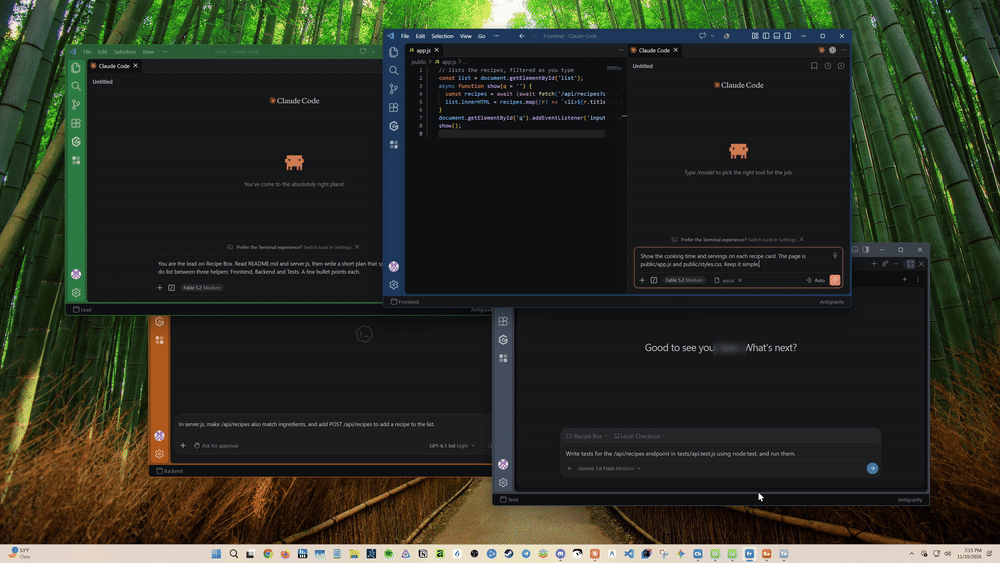
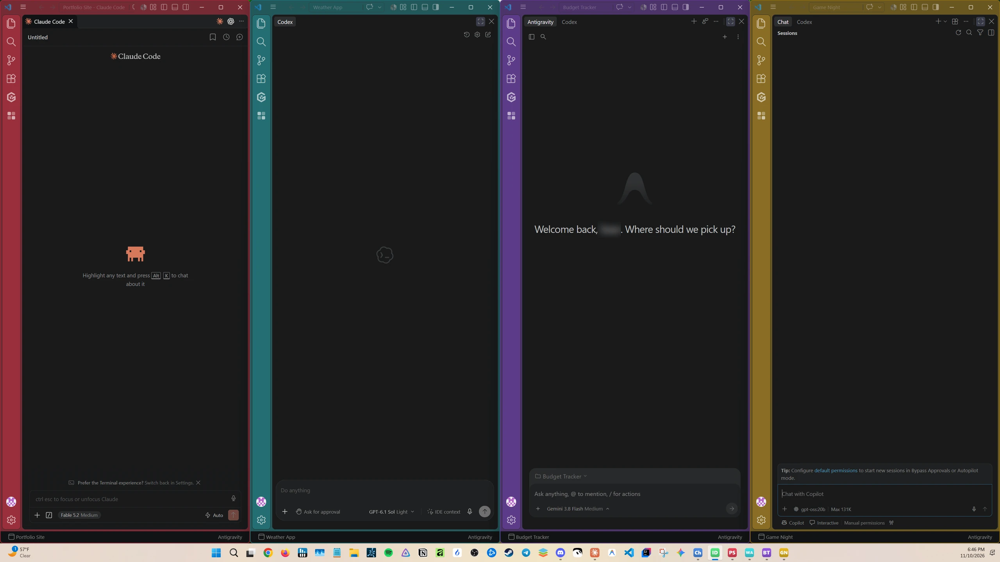
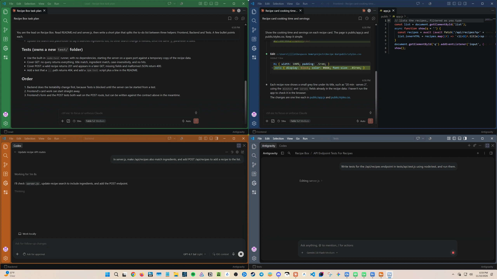

# Vibespaces

**One VS Code window per project: its own colour, its own taskbar button, one click to open.**



<!-- TOUR VIDEO: on github.com, edit this file and drag vibespaces-tour-1080p.mp4 onto this line; GitHub swaps in a player. -->

If you work on several projects, VS Code windows look alike and all pile up under one blue taskbar icon.
Vibespaces turns each project into a **space**:

- it opens in **its own window**, with the title bar and bottom bar in the project's colour;
- on Windows it gets **its own taskbar button** in that colour, which you can pin;
- it **remembers how you left it**, and can open the panels you like (Claude Code, the file list, a terminal…).

No files to edit: everything has a button or a form.


*Every project in its own colour, with its own taskbar button and its own assistant.*


*A group: one project, four agents side by side, each window in its spot.*

## Getting started

The first time Vibespaces runs, a short guide opens (**Get started with Vibespaces**). To see it again, press
**Ctrl+Shift+P** and run **Vibespaces: How Vibespaces Works**.

1. **Make a space.** Open your project folder in VS Code (*File > Open Folder…*), click the Vibespaces icon
   (four small squares) on the far left, then **Make This Window a Space**. Name it and pick a colour.
2. **Switch spaces.** Click a space in the Vibespaces list, or the space name at the bottom left of the window.
3. **Pin it** (Windows). Right-click the space's taskbar button and choose **Pin to taskbar**.
4. **Change it.** Click the gear next to a space: name, colour, folders, taskbar icon, what opens with it.
   Start from a preset (an AI assistant filling the window: Claude, Codex, Antigravity, Gemini, Grok, Copilot, Cline; or a layout; or one you saved), and put the window
   in a column, a half or full screen, or exactly where you saved it. Moved things around? **Ctrl+Alt+Home** puts the space's
   panels, layout and window position back.
5. **Groups** (Windows). Spaces that work side by side: open them together, each in its spot, and put them all back
   with **Ctrl+Alt+Shift+Home**. Make one with the + under *Groups* in the Vibespaces side bar. Right-click a group
   and choose **Group Shortcut…** to give it its own key (say Ctrl+Alt+Shift+1), so each group comes up on its own.
6. **Settings for all spaces** are under **Settings** in the Vibespaces side bar: which parts get coloured, bold or
   subtle, and the taskbar options.

Deleting a space removes only its small space file (to the Recycle Bin), never your project.

## Words you'll see

| Word | What it means |
|---|---|
| **Folder** | Where your project's files live, like `Documents\My Website`. |
| **Window** | One VS Code window. Each space opens in its own. |
| **Space** | A project set up with Vibespaces: a name, a colour and the folder(s) it opens. |
| **Workspace file** | The small `.code-workspace` file that holds a space. Vibespaces keeps them in `Documents\Vibespaces`. |

---

## For developers

A space is a `.code-workspace` file in the spaces folder. Its name is the file name; Vibespaces keeps its own keys
in the file's `settings` (`vibespaces.id`, `vibespaces.color`, `vibespaces.iconStyle`, `vibespaces.iconImage`,
`vibespaces.onOpen`) and paints `workbench.colorCustomizations` from the colour. Edits keep the file's comments.

**The taskbar (Windows).** Windows groups taskbar buttons by app ID, and every VS Code window shares one. When a
space opens, Vibespaces finds its window (the extension host's parent process, title starting with the space name),
sets the window's own ID plus a relaunch command, icon and name (the shell's per-window `PKEY_AppUserModel_*`
properties), then hides and shows the window once so the taskbar reads them. The ID is stored in the space file, so
a rename keeps the pin. Closing the window clears the properties; they're set again on the next open.

**The helper program (Windows).** Everything Windows-specific (taskbar identity, moving and raising windows, the
global shortcut, making icons) is done by `vibespaces-helper.exe`, a small program built from the C# in `helper/`
with the compiler that ships with Windows (.NET Framework 4). The extension runs it with arguments for each job; for
the global shortcut, one copy keeps running and stops when VS Code closes. It doesn't touch the network or any files
except the space icons it's asked to make.

| Setting | Default | |
|---|---|---|
| `vibespaces.folder` | `Documents/Vibespaces` | where the space files live |
| `vibespaces.colorTargets` | title bar, status bar | which parts are coloured |
| `vibespaces.intensity` | `bold` | `bold` or `subtle` |
| `vibespaces.taskbar` | on | Windows taskbar buttons per space |
| `vibespaces.iconStyle` | `window` | `window`, `initials`, `image`, or the opt-in `vscode` (a space can override it) |

### Build

```
npm install
npm run compile
npm run build:helper   # Windows: builds helper/vibespaces-helper.exe
npm run package        # makes vibespaces-<version>.vsix (builds both first)
code --install-extension vibespaces-<version>.vsix
```

### Icons and VS Code's logo

The default taskbar icon is a little app window in the space's colour; *initials* and *your own picture* are the other
styles. The *VS Code logo* style is opt-in: it recolours the icon of the VS Code installed on your PC, on your PC
(the logo isn't part of this extension). VS Code's [brand guidelines](https://code.visualstudio.com/brand) don't allow
modified versions of its logo, so keep that style for your own use and out of screenshots you share. Editors that
don't ship VS Code's icon file (Cursor, Windsurf...) fall back to the window.

## Licence

MIT. See [LICENSE](LICENSE).
